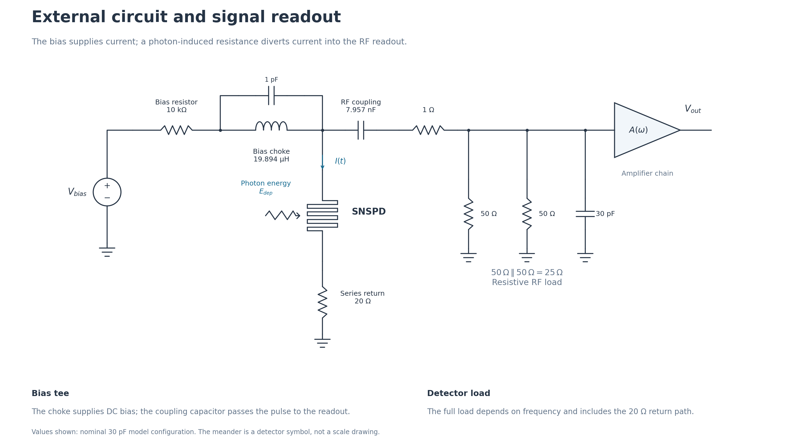

# SNSPD simulation

Version 0.1.2 · 17 November 2026

NbN detector models for Geiger and near-transition calorimetric responses, with
a shared readout circuit, reference simulations, experimental curves, and an
editable presentation.

The original framework is from **Berggren et al. (2018)**,
[“A superconducting nanowire can be modeled by using SPICE”](https://doi.org/10.1088/1361-6668/aab149),
and the [MIT QNN library](https://github.com/qnngroup/snspd-spice). Cite that paper
and identify this repository's modifications when using the models.
See [attribution](NOTICE.md), [BibTeX](docs/references.bib), and [citation metadata](CITATION.cff).

## Models

| Model | Location | Scope |
|---|---|---|
| Simplified Geiger model (`nanowireBCF`) | `legacy/snspd_geiger.lib` | Inductive flux, hotspot-current plateau, and switching thresholds |
| Earlier dynamic Geiger model (`nanowireDynamic`) | `legacy/snspd_geiger.lib` | Hotspot-boundary evolution and a restoration switch |
| Latest electrothermal model (`nanowireElectrothermal_NbN_v5c`) | `models/snspd_nbn_v5c.lib` | Shared equations for Geiger and near-transition calorimetric responses |

The latest model evolves detector current, two seed temperatures, and domain
resistance using the same equations in both regimes. Fixed 38 nH inductance is
the default; an experimental [current-dependent option](docs/current_dependent_inductance.md)
is available. The 32-case reference set and the option's separate regression
results are documented in [validation and limitations](docs/validation.md).

## Quick start

Requirements: Python 3.12, LTspice, and its standard `opamp.sub`.

```sh
python3 -m venv .venv
source .venv/bin/activate
python3 -m pip install -r requirements.txt
python3 snspd.py check
python3 snspd.py list
python3 snspd.py run --smoke --jobs 2 --compare
```

On Windows, activate with `.venv\Scripts\activate` and use `python`.
Installation paths can be set with `--ltspice` and `--opamp`, or the environment
variables `LTSPICE_EXECUTABLE` and `LTSPICE_OPAMP_SUB`.

Results go to `runs/`. Existing simulations require `--overwrite` or a different
`--output` directory. Use `build` instead of `run` to prepare the latest model's
netlists without executing LTspice. Full regression commands are in
[reproducibility](docs/reproducibility.md); earlier-model examples are in the
[legacy guide](legacy/README.md).



## Documentation

| Reference | Contents |
|---|---|
| [Model](docs/model.md) | State equations, parameters, and optical normalization |
| [SNSPD structure](docs/snspd.md) / [implementation](docs/snspd_implementation.md) | Component functions, ports, and SPICE element mapping |
| [External circuit](docs/circuit.md) / [concept figures](docs/concepts.md) | Connections, loads, and amplifier stages |
| [Current-dependent inductance](docs/current_dependent_inductance.md) | Optional GL flux law and usage |
| [Validation](docs/validation.md) | Numerical results, measurement definitions, and physical limits |
| [Model lineage](docs/model_lineage.md) | Relation to the original models and later literature |
| [Response data](docs/response_data.md) | Waveform processing, plots, and the Keynote presentation |
| [Reproducibility](docs/reproducibility.md) | Regression commands, provenance, and source packaging |
| [Recovery experiment](experiments/falling_time/README.md) | Controlled comparisons of candidate falling-time mechanisms |
