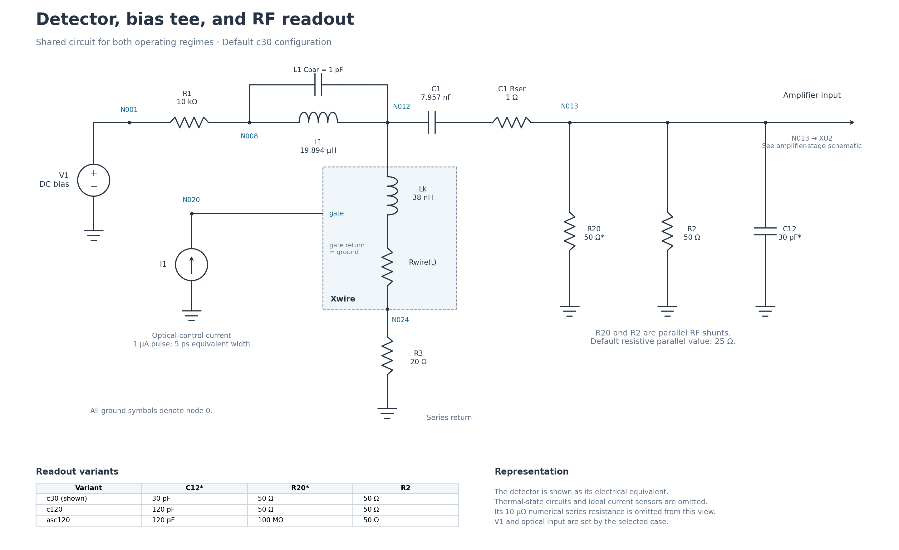
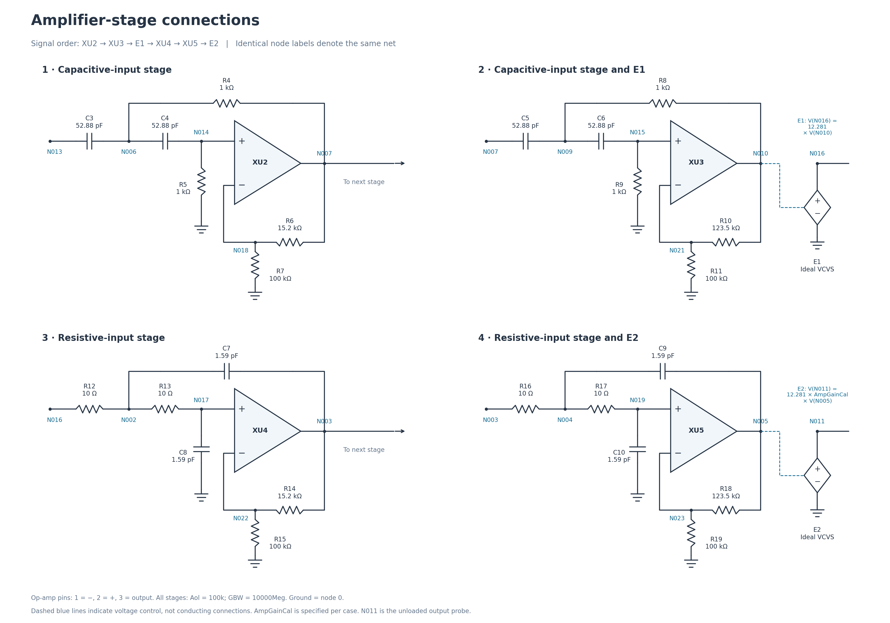

# External circuit

For presentation figures without simulation identifiers, see
[circuit and model concepts](concepts.md).

The package retains the complete external circuit. The schematics below show the
connections and values in the simulation netlists for both operating regimes.
Download the [four-page vector PDF](figures/circuit_schematics.pdf),
[overview SVG](figures/circuit_overview.svg), or
[amplifier SVG](figures/amplifier_stages.svg).

Identical node labels denote the same electrical net; every ground symbol is
node `0`. The detector uses the original meander and photon-arrow geometry from
the installed `snspdWithPhotonPort.asy` symbol. Its current-model ports are mapped
by `SpiceOrder`. The optical-control source drives `gate` at `N020`; its return
is grounded. This control current represents optical input to the model.
The separate [SNSPD implementation reference](snspd_implementation.md) shows the internal electrical path,
state integrators, and electrothermal feedback.

The coupling capacitor has a 1 Ω series resistance. The bias inductor includes
1 pF parallel capacitance. The 20 Ω resistor is in the detector source return;
it is not another resistor in parallel with the RF terminations.

## Circuit variants

| Variant | RF capacitance | Additional shunt R20 | R2 | Use |
|---|---:|---:|---:|---|
| `c30` | 30 pF | 50 Ω | 50 Ω | Common circuit for the current Geiger and near-transition comparison |
| `c120` | 120 pF | 50 Ω | 50 Ω | Capacitance sensitivity at fixed shunts |
| `asc120` | 120 pF | 100 MΩ | 50 Ω | External values from the existing calorimetry schematic |

Two 50 Ω RF resistors have a parallel resistance of 25 Ω. The complete impedance
seen by the detector remains frequency-dependent because of the coupling network,
RF capacitance, amplifier input network, and series return path.
R2 and R20 are explicit shunts in the model. A bias tee's nominal 50 Ω impedance
does not by itself establish an additional physical 50 Ω shunt.

The current Geiger schematic specifies 30 pF. A historical readout file used
150 pF; its retriggering comparison is retained only as a labeled reference figure.
Neither schematic value establishes a measured parasitic capacitance.

The `asc120` cases reuse the external values of `SNSPD_calorimetry.asc` with the
shared v5c detector. They do not reproduce that schematic's older v2 detector or
its original optical-control pulse.

## Amplifier and bias conventions

The signal sequence is `N013 → XU2 → XU3 → E1 → XU4 → XU5 → E2 → N011`.
Each stage shows its input network and both feedback paths. The LTspice `opamp`
subcircuit uses pin 1 for the inverting input, pin 2 for the non-inverting input,
and pin 3 for the output. Dashed blue lines indicate voltage control of E1 and E2;
they are not conducting wires. Both controlled voltages are referenced to ground.

The amplifier transfer circuit is preserved in `circuits/amplifier_chain.inc`.
Its op-amp model is loaded from the installed LTspice distribution. E1 and E2 have
nominal gains of 12.281; selected historical Geiger reference cases apply an
additional E2 factor of 0.835779. The factor is explicit in each case and does not
feed back into the detector.

Calorimetric and 1 V Geiger cases use an E2 calibration factor of 1. Output voltages
from cases with different gain factors must be normalized before direct comparison.
The final E2 output is measured without an additional load. The model does not
represent amplifier saturation, noise, or a physical output impedance.

Bias is prepared with a DC voltage source through 10 kΩ and the 20 Ω return path.
The main Geiger bias is 0.96 Isw, approximately 122.5 µA. Separate 1 V cases retain
the original schematic voltage, giving approximately 99.8 µA. These are distinct
operating points.

## Regenerating the schematics

Run `python3 scripts/draw_circuit.py` from the repository root. The renderer
checks the drawn node connections for all 37 components in the two external
circuit files, 25 internal model elements, and the generated source polarities
and detector ports. The symbol geometry is stored in `symbols/snspd_geometry.json`.
It writes PNG, SVG, and PDF figures to `docs/figures/` and a component/node manifest
to `provenance/circuit_diagram_manifest.json`. A topology change requires updating
the drawing layout. These checks establish agreement with the netlists, not
experimental verification of the circuit.
