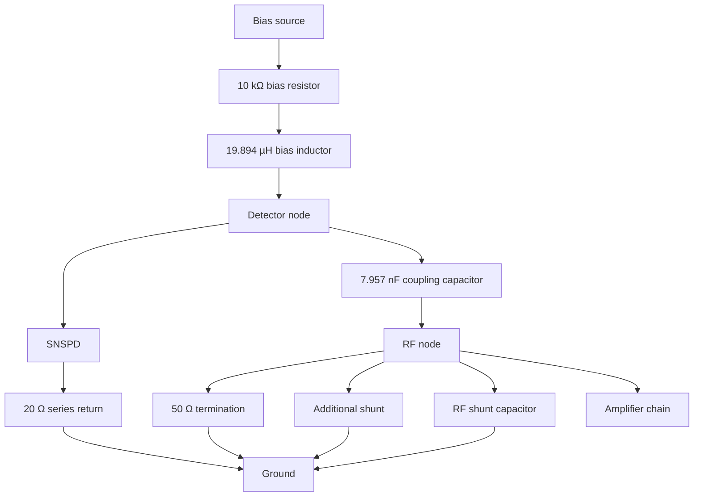

# External circuit

The package retains the complete external circuit. It does not replace the
detector environment with a single resistance.

The coupling capacitor has a 1 Ω series resistance. The bias inductor includes
1 pF parallel capacitance. The 20 Ω resistor is in the detector source return;
it is not another resistor in parallel with the RF terminations.

## Circuit variants

| Variant | RF capacitance | Additional shunt R20 | R2 | Use |
|---|---:|---:|---:|---|
| `c30` | 30 pF | 50 Ω | 50 Ω | Common circuit for the current Geiger and near-transition comparison |
| `c120` | 120 pF | 50 Ω | 50 Ω | Capacitance sensitivity at fixed shunts |
| `asc120` | 120 pF | 100 MΩ | 50 Ω | External values from the existing calorimetry schematic |

Two 50 Ω RF resistors have a parallel resistance of 25 Ω. The complete impedance
seen by the detector remains frequency-dependent because of the coupling network,
RF capacitance, amplifier input network, and series return path.

The current Geiger schematic specifies 30 pF. A historical readout file used
150 pF; its retriggering comparison is retained only as a labeled reference figure.
Neither schematic value establishes a measured parasitic capacitance.

The `asc120` cases reuse the external values of `SNSPD_calorimetry.asc` with the
shared v5c detector. They do not reproduce that schematic's older v2 detector or
its original optical-control pulse.

## Amplifier and bias conventions

The amplifier transfer circuit is preserved in `circuits/amplifier_chain.inc`.
Its op-amp model is loaded from the installed LTspice distribution. E1 and E2 have
nominal gains of 12.281; selected historical Geiger reference cases apply an
additional E2 factor of 0.835779. The factor is explicit in each case and does not
feed back into the detector.

Calorimetric and 1 V Geiger cases use an E2 calibration factor of 1. Output voltages
from cases with different gain factors must be normalized before direct comparison.
The final E2 output is measured without an additional load. The model does not
represent amplifier saturation, noise, or a physical output impedance.

Bias is prepared with a DC voltage source through 10 kΩ and the 20 Ω return path.
The main Geiger bias is 0.96 Isw, approximately 122.5 µA. Separate 1 V cases retain
the original schematic voltage, giving approximately 99.8 µA. These are distinct
operating points.
