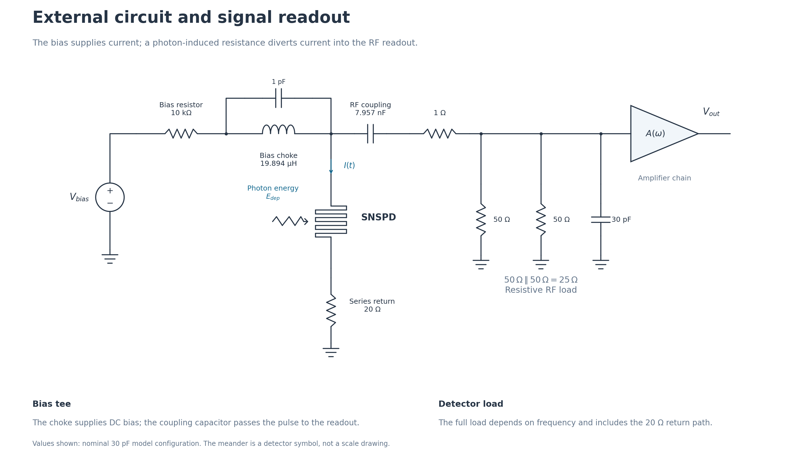
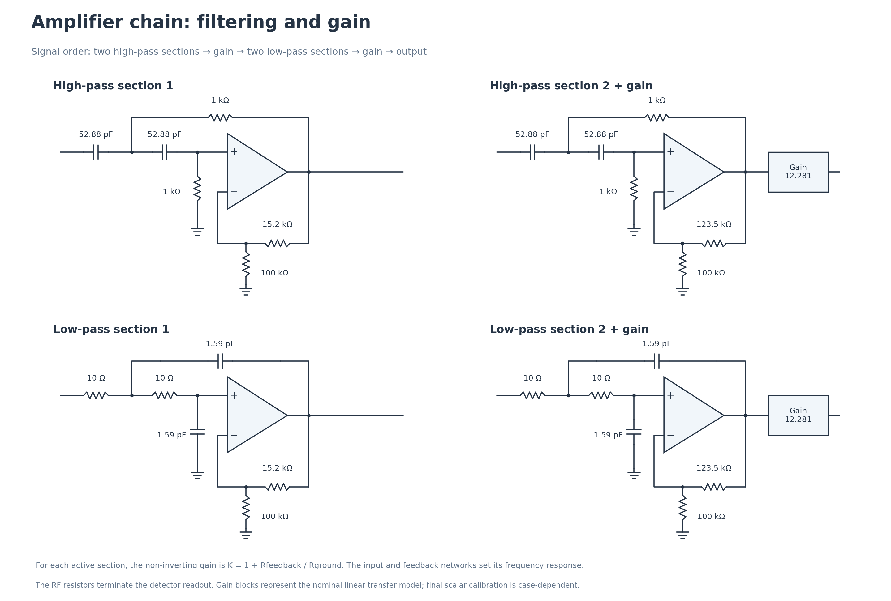

# Circuit and model concepts

These figures explain the circuit and physical model using component values and
physical quantities. Simulation node labels and element identifiers are omitted.
Download the [three-page concept PDF](figures/model_concepts.pdf).

## External circuit

[Vector SVG](figures/concept_external_circuit.svg)

The voltage source biases the detector through the 10 kΩ resistor and bias choke.
The RF coupling capacitor passes the transient pulse to the readout. The two
explicit 50 Ω shunts give a 25 Ω resistive parallel load; the complete detector
load also includes the series return and frequency-dependent elements.

The drawing uses the original SNSPD meander and photon-arrow geometry from the
installed symbol library. Optical excitation is shown as deposited photon energy.
The numerical gate-current source is omitted. The values correspond to the
nominal 30 pF model configuration, not a new measurement of the apparatus.

## Amplifier chain

[Vector SVG](figures/concept_amplifier.svg)

The readout combines two active high-pass sections and two active low-pass
sections with nominal gain blocks. Each op-amp's resistive divider sets its
non-inverting gain; the surrounding resistors and capacitors determine the
frequency response. Final amplitude calibration depends on the selected case.

## SNSPD

The [SNSPD concept section](snspd.md) gives the electrical equation, two-temperature
seed equations, and the feedback between resistance, current, and heating.

Regenerate these figures with `python3 scripts/draw_concepts.py`. The detailed
[external-circuit reference](circuit.md) and
[SNSPD implementation reference](snspd_implementation.md) retain identifiers for
code inspection, independently of the presentation figures.
