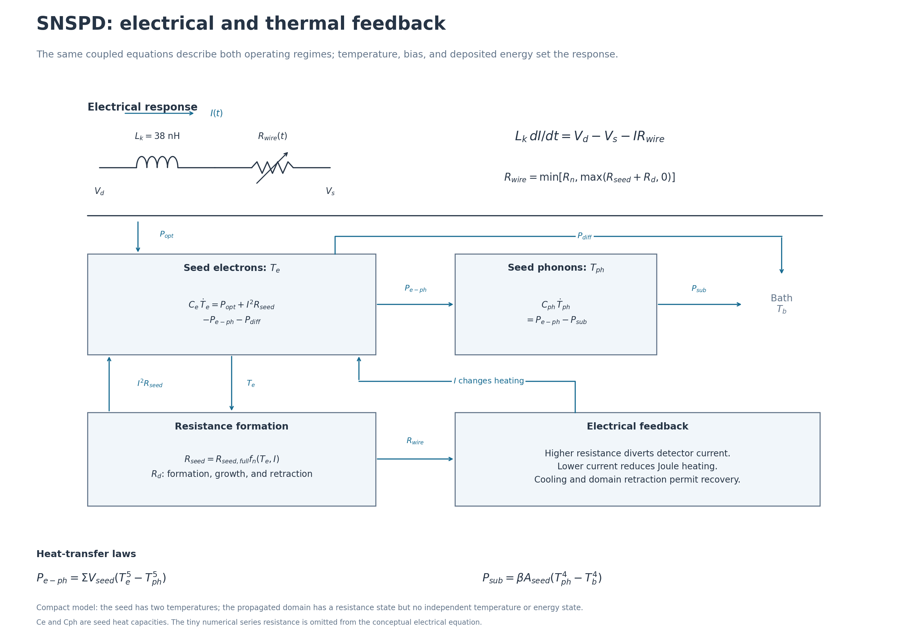

# SNSPD model concept

The SNSPD is represented by a kinetic inductance and a resistance that changes
through coupled electrical and thermal dynamics. Optical absorption creates a
heated seed; the seed can also drive formation and propagation of a normal domain.

[Vector SVG](figures/concept_snspd.svg) ·
[Concept figures PDF](figures/model_concepts.pdf)

## Electrical response

The detector current obeys

$$
L_k\frac{dI}{dt}=V_d-V_s-I R_{\mathrm{wire}}.
$$

Here, the tiny numerical series resistance is omitted for clarity. The total
wire resistance combines the seed and propagated domain, bounded by the
full normal-state wire resistance:

$$
R_{\mathrm{wire}}=\min[R_n,\max(R_{\mathrm{seed}}+R_d,0)].
$$

When resistance rises, current is diverted into the external readout. The resulting
change in current modifies Joule heating and subsequent resistance evolution.

## Thermal response

The seed contains coupled electron and phonon subsystems:

$$
C_e\dot T_e=P_{\mathrm{opt}}+I^2R_{\mathrm{seed}}
-P_{e-ph}-P_{\mathrm{diff}},
$$

$$
C_{ph}\dot T_{ph}=P_{e-ph}-P_{\mathrm{sub}}.
$$

The adopted heat-transfer laws are

$$
P_{e-ph}=\Sigma V_{\mathrm{seed}}(T_e^5-T_{ph}^5),\qquad
P_{\mathrm{sub}}=\beta A_{\mathrm{seed}}(T_{ph}^4-T_b^4).
$$

| Quantity | Physical meaning |
|---|---|
| $I,L_k$ | Detector current and kinetic inductance |
| $V_d,V_s$ | Voltages at the two detector terminals |
| $T_e,T_{ph},T_b$ | Electron, phonon, and bath temperatures |
| $C_e,C_{ph}$ | Total heat capacities of the seed subsystems |
| $R_{seed},R_d,R_n$ | Seed, propagated-domain, and full normal-state resistance |
| $P_{opt}$ | Deposited optical power |
| $P_{diff}$ | Electron heat loss to the surrounding wire |
| $\Sigma,\beta$ | Electron–phonon and substrate heat-transfer coefficients |
| $V_{seed},A_{seed}$ | Seed volume and substrate-contact area |

The seed resistance depends continuously on temperature and current. The domain
resistance evolves through formation, growth, and retraction, including a
finite-size survival penalty. Together these processes close the feedback loop
between temperature, resistance, current, and heating.

## Operating regimes and scope

Geiger and near-transition calorimetric cases use the same equations. Their bath
temperature, prepared bias, and optical input differ. There is no mode selector.
The regimes must be identified from the simulated response; the drawings alone
do not establish saturation, energy resolution, or a bias-dependent output decay.

The model tracks four states: current, two seed temperatures, and domain
resistance. The propagated domain does not have an independent temperature or
thermal-energy state. Its Joule power is not added to the seed heat balance.

See [model parameters](model.md) and [validation](validation.md) for quantitative
results and limitations. The [implementation reference](snspd_implementation.md)
maps these concepts to the code and numerical auxiliary circuits.
