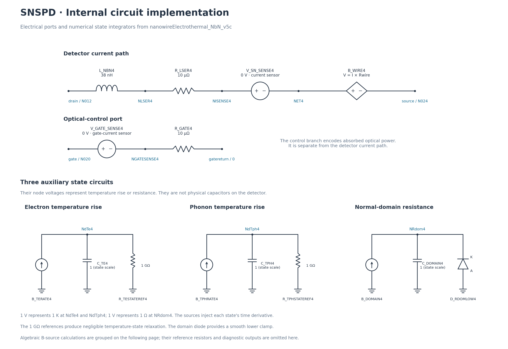
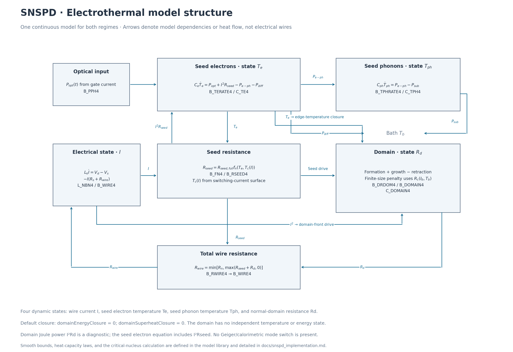

# SNSPD implementation reference

For presentation figures and physical notation, see the [SNSPD concept](snspd.md).
This reference retains simulation identifiers for readers tracing the code.

The external schematic uses the meander and photon-arrow geometry from the
installed `snspdWithPhotonPort.asy` symbol. The geometry identifies the detector;
it does not specify the fabricated layout or resolve its temperature spatially.
The internal implementation is the packaged
[`nanowireElectrothermal_NbN_v5c` model](../models/snspd_nbn_v5c.lib).

## Symbol and port mapping

The current subcircuit declares `gate gatereturn drain source`. Connections follow
the symbol's `SpiceOrder`, rather than its legacy pin names:

| Order | Current model port | External node | Function |
|---|---|---|---|
| 1 | `gate` | `N020` | Optical-control current input |
| 2 | `gatereturn` | `0` | Optical-control return |
| 3 | `drain` | `N012` | Detector terminal connected to the bias tee |
| 4 | `source` | `N024` | Detector terminal connected to the 20 Ω return resistor |

The installed symbol labels pins 3 and 4 as `source` and `drain`, respectively.
The figures use the current model's names shown above. The gate pair is a
simulation interface for optical excitation, not a second physical current path
through the nanowire. The original symbol coordinates and pin metadata are
retained in [`symbols/snspd_geometry.json`](../symbols/snspd_geometry.json).
Only drawing geometry is reused; the legacy symbol's model selection and
parameter overrides are not imported.

## Internal circuit

[Vector SVG](figures/snspd_internal_circuit.svg) ·
[Complete four-page PDF](figures/circuit_schematics.pdf)

The detector current passes through `L_NBN4`, `R_LSER4`, `V_SN_SENSE4`, and
`B_WIRE4` in series. The fixed inductance is 38 nH; the explicit numerical series
resistance is 10 µΩ. `V_SN_SENSE4` is an ideal 0 V source used to measure current.
`B_WIRE4` implements the resistive voltage:

$$
V_{\mathrm{WIRE}}=I R_{\mathrm{wire}},\qquad
R_{\mathrm{wire}}=\min\!\left[R_n,\max(R_{\mathrm{seed}}+R_d,0)\right].
$$

`B_RWIRE4` computes this bounded resistance. `Rseed` and `Rd` are internal model
quantities; they are not additional discrete resistors connected externally.
The optical-control branch contains its own 0 V current sensor and 10 µΩ
resistor. `B_PPH4` converts the sensed gate current into deposited optical power.

Three auxiliary circuits integrate the thermal and domain variables:

| State coordinate | Integrating capacitor | Driving source | Additional element |
|---|---|---|---|
| `V(NdTe4)` represents electron temperature rise in K | `C_TE4` | `B_TERATE4` | `R_TESTATEREF4 = 1 GΩ` |
| `V(NdTph4)` represents phonon temperature rise in K | `C_TPH4` | `B_TPHRATE4` | `R_TPHSTATEREF4 = 1 GΩ` |
| `V(NRdom4)` represents normal-domain resistance in Ω | `C_DOMAIN4` | `B_DOMAIN4` | Lower-clamp diode `D_RDOMLOW4` |

Each capacitor has a numerical value of 1 in the SPICE state representation.
For a unit capacitance, the injected current gives the time derivative of its
node voltage. The thermal driving sources divide net power by the calculated
seed heat capacity; `C_TE4` and `C_TPH4` are therefore not the physical heat
capacities. The two 1 GΩ reference resistors introduce a 10⁹ s numerical decay
time. The domain diode supplies a smooth lower clamp, not an event-triggered
reset. Algebraic B sources and their reference resistors are grouped in the
following diagram; diagnostic circuits are not drawn individually.

## Electrothermal feedback

[Vector SVG](figures/snspd_electrothermal_structure.svg)

The detector has four dynamic states: wire current, seed electron temperature,
seed phonon temperature, and normal-domain resistance. The principal coupling is:

1. Optical power and seed Joule heating raise the electron temperature. Electron–
   phonon exchange and diffusion remove energy from the electron subsystem.
2. Phonons receive electron–phonon power and exchange heat with the substrate.
3. Electron temperature and current determine the seed's excess normal fraction
   and resistance through `B_FN4` and `B_RSEED4`.
4. The heated seed drives domain formation. The domain evolves through continuous
   growth, retraction, and a finite-size survival penalty in `B_DRDOM4`.
5. Seed and domain resistance determine `Rwire`, which changes the electrical
   current and hence subsequent Joule heating.

The diagram shows the principal equations; the library also applies smooth
regularizations and temperature bounds. `T_e` and `T_ph` used in material laws
are obtained from the bath temperature plus the integrated rises, with the
implemented 1 mK floor and 50 K upper bound. The domain critical scale
`RcritUse4` is evaluated at the prepared bias and bath temperature. It is not
an additional dynamic state.

The default model uses `domainEnergyClosure=0` and `domainSuperheatClosure=0`.
The propagated domain has no independent temperature or thermal-energy state.
Its Joule power `I²Rd` is recorded by `B_PJDOMAIN4`; it is not added to the seed
electron equation, which includes `I²Rseed`. This is a compact closure, not a
spatially resolved global energy-balance model.

Geiger and calorimetric cases use this same structure. Their temperature, bias,
and optical excitation differ; there is no mode selector or reset switch.
See [model equations and parameters](model.md) and
[observed behavior and limitations](validation.md) for the supported conclusions.

## Figure provenance

`scripts/draw_circuit.py` reproduces all four figures and checks the external
connections plus 25 internal element cards used in these views. The manifest
records the symbol pin mapping and source hashes. The checks establish agreement
with the packaged model; they do not validate its physical approximations.
