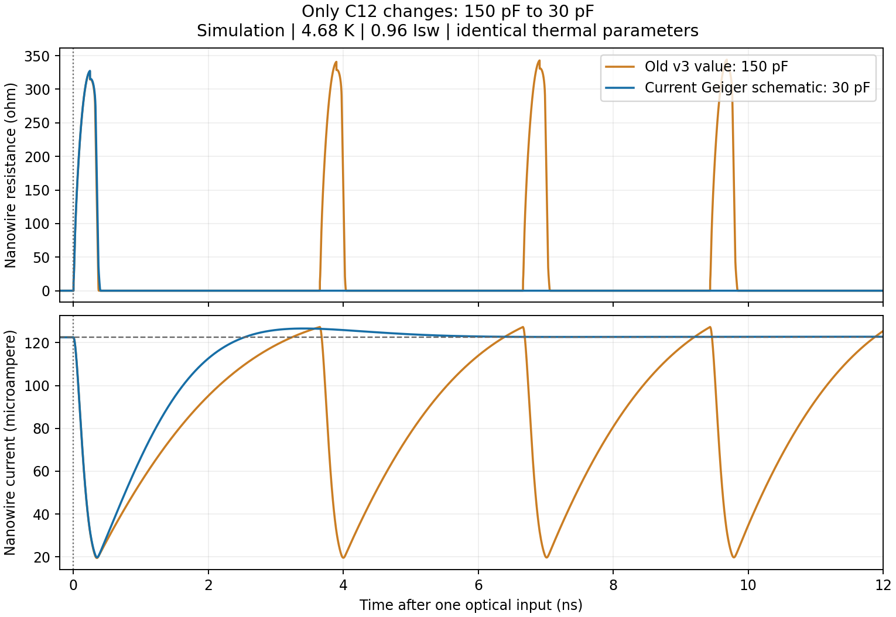

# Validation record

The reference measurements were obtained on 17 November 2026 using the shared
numerically revised v5c model. All results below are simulations.

## Geiger regime

Conditions: 4.68 K, Isw = 127.6286 µA, 30 pF RF capacitance, two 50 Ω RF shunts,
and a 20 Ω detector return resistor.

| Test | Result |
|---|---|
| 0.96 Isw, N = 1 | Wire resistance returns below 1 Ω approximately 0.397 ns after optical input. |
| 0.96 Isw, N = 1 versus N = 8 | Amplifier peaks differ by approximately 0.012%. Both cases recover. |
| 0.96 Isw, N = 0 | No spontaneous resistance event. |
| 800 ns observation after N = 1 input | One event; no subsequent retriggering. |
| Original 1 V bias, N = 1 | No trigger. This is not a successful detection-and-reset test. |
| Original 1 V bias, N = 8 | One event followed by recovery. |

Halving the maximum step from 0.05 to 0.025 ps changes the N = 1 output peak by
approximately 0.000012%. These results apply to the stated operating conditions.

## Near-transition regime

Conditions: 11.47 K, Isw = 13 µA, and the same shared detector equations.
The primary comparison uses the 30 pF circuit with two 50 Ω RF shunts.

At 0.90 Isw:

| Optical input multiplier N | Deposited energy (eV) | Output peak (mV) |
|---:|---:|---:|
| 1 | 0.2332 | 16.2621 |
| 2 | 0.4664 | 16.1732 |
| 4 | 0.9328 | 15.8513 |
| 10 | 2.3321 | 24.5628 |
| 100 | 23.3212 | 45.8303 |

The response is energy-dependent and nonlinear. The small decrease from N = 1 to
N = 4 remains under step refinement. Peak amplitude is therefore not a validated
one-to-one energy estimator over the complete tested range.

For fixed N = 10:

| Ib/Isw | Internal resistance fall, 90–10% (ps) | Output fall, 90–10% (ns) |
|---:|---:|---:|
| 0.60 | 25.833 | 1.533004 |
| 0.80 | 60.238 | 1.533173 |
| 0.90 | 81.399 | 1.533073 |
| 0.96 | 90.386 | 1.532966 |

Internal resistance recovery slows with bias. A substantial increase in the
amplifier-output fall time is not reproduced. The two 120 pF variants also lack
this trend; their output fall times are approximately 2.600 and 2.759 ns.

All tested nonzero-input cases recover. A 0.96 Isw, N = 10 case observed for 800 ns
contains one event. Three maximum-step comparisons, 0.05 versus 0.025 ps, change
output peaks by at most 0.0083%. Long observations use 0.5 ps and assess recovery,
not the precision of the first pulse.

## Measurement definitions

- **Output peak:** maximum amplifier output after subtracting the time-weighted
  mean from 2 to 1 ns before optical input.
- **Output fall time:** time between the first descending 90% and 10% crossings
  after the main peak. It is distinct from absolute time to the second zero.
- **Resistance recovery:** first post-peak time after which Rwire remains below
  1 Ω throughout the observation window. It does not imply instantaneous current recovery.
- **Recovered state:** late resistance below 1 Ω, average current within 1% of
  the specified bias, and average seed electron temperature within 0.01 K of the bath.
- **Event count:** resistance-peak groups above the analysis thresholds, separated
  by more than 0.5 ns. It is a numerical event classification, not a detection probability.

## Remaining limits

### Physical consistency and validation scope

The model is a physically motivated, semi-empirical approximation. Its electrical
equation couples kinetic inductance and a nonnegative wire resistance to the
readout circuit. In the stated seed heat balances, electron–phonon heat flow
appears with opposite signs, so that exchange cancels when the two balances are
added. Optical input, seed Joule heating, substrate cooling, and diffusion have
explicit roles. These structural properties support the model's interpretation;
they do not establish the accuracy of its parameters or domain dynamics.

The developed domain is represented by a resistance and a boundary-evolution
law, without its own temperature or stored thermal-energy state. Domain Joule
heating enters the boundary-driving approximation, but its diagnostic power is
not integrated in a separate domain energy balance. Global thermal-energy
closure has therefore not been demonstrated. The finite-size penalty and
prepared-bias critical scale also require independent validation.

Shared equations do not establish a calibrated continuous transition between
regimes. The switching current is supplied separately at each bath temperature,
and some stored cases use different readout gain calibrations. Fixed kinetic
inductance and uncalibrated deposited optical energy further limit quantitative
comparison with experiment. The low-energy non-monotonicity reported above
remains unresolved.

The current evidence supports studying mechanisms and comparing simulated
responses within the tested conditions. It does not support treating all
parameter values as measured device properties, claiming full thermal-energy
conservation, or claiming quantitative validation of calorimetric performance.

### Numerical and experimental limits

The integral electrical-balance residual reaches approximately 0.43%, normalized
by Lk × Ib. Step convergence does not establish exact internal balances or physical
parameter validity. The developed-domain energy closure, fixed kinetic inductance,
optical-energy calibration, and amplifier approximations remain limitations.

The package does not establish energy resolution, detection efficiency, noise,
timing jitter, or agreement with measured waveforms. Passing reference comparisons
means reproduction of the stored numerical baseline, including its known limitations.
