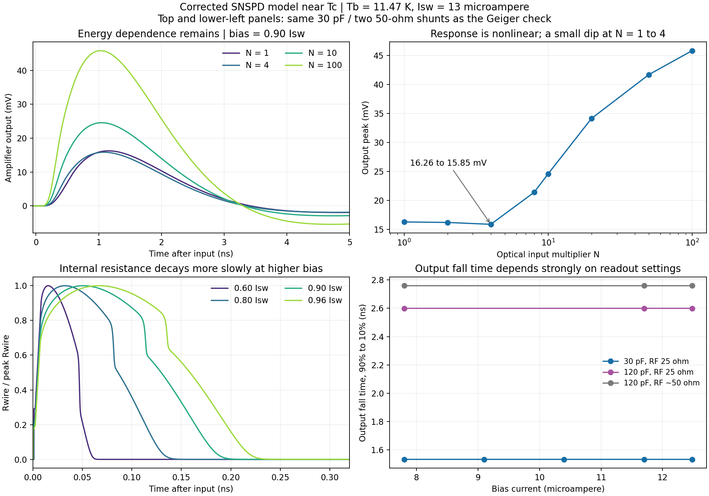

# Validation record

The fixed-inductance reference measurements were recorded on 17 November 2026;
the GL option was checked on 18 November. All results below are simulations.

## Geiger regime

Conditions: 4.68 K, Isw = 127.6286 µA, 30 pF RF capacitance, two 50 Ω RF shunts,
and a 20 Ω detector return resistor.

| Test | Result |
|---|---|
| 0.96 Isw, N = 1 | Wire resistance returns below 1 Ω approximately 0.397 ns after optical input. |
| 0.96 Isw, N = 1 versus N = 8 | Amplifier peaks differ by approximately 0.012%. Both cases recover. |
| 0.96 Isw, N = 0 | No spontaneous resistance event. |
| 800 ns observation after N = 1 input | One event; no subsequent retriggering. |
| Original 1 V bias, N = 1 | No trigger. This is not a successful detection-and-reset test. |
| Original 1 V bias, N = 8 | One event followed by recovery. |

Halving the maximum step from 0.05 to 0.025 ps changes the N = 1 output peak by
approximately 0.000012%. These results apply to the stated operating conditions.

## Near-transition regime

Conditions: 11.47 K, Isw = 13 µA, and the same shared detector equations.
The primary comparison uses the 30 pF circuit with two 50 Ω RF shunts.

At 0.90 Isw:

| Optical input multiplier N | Deposited energy (eV) | Output peak (mV) |
|---:|---:|---:|
| 1 | 0.2332 | 16.2621 |
| 2 | 0.4664 | 16.1732 |
| 4 | 0.9328 | 15.8513 |
| 10 | 2.3321 | 24.5628 |
| 100 | 23.3212 | 45.8303 |

The response is energy-dependent and nonlinear. The small decrease from N = 1 to
N = 4 remains under step refinement. Peak amplitude is therefore not a validated
one-to-one energy estimator over the complete tested range.

For fixed N = 10:

| Ib/Isw | Internal resistance fall, 90–10% (ps) | Output fall, 90–10% (ns) |
|---:|---:|---:|
| 0.60 | 25.833 | 1.533004 |
| 0.80 | 60.238 | 1.533173 |
| 0.90 | 81.399 | 1.533073 |
| 0.96 | 90.386 | 1.532966 |

Internal resistance recovery slows with bias. A substantial increase in the
amplifier-output fall time is not reproduced. The two 120 pF variants also lack
this trend; their output fall times are approximately 2.600 and 2.759 ns.

All tested nonzero-input cases recover. A 0.96 Isw, N = 10 case observed for 800 ns
contains one event. Three maximum-step comparisons, 0.05 versus 0.025 ps, change
output peaks by at most 0.0083%. Long observations use 0.5 ps and assess recovery,
not the precision of the first pulse.

## Current-dependent inductance

The [GL option](current_dependent_inductance.md) was tested with $L_0=38$ nH and
$I_d/I_{\mathrm{sw}}=1.2$. The [verification record](../provenance/inductance_verification.json)
contains all 64 runs and 32 checks; every check passed. All 32 default netlists
were identical to commit `d40f46f4b8886eb2996866fb5c73768004f4a0f4`, and the
18 Python unit tests passed. Commands and tolerances are in
[reproducibility](reproducibility.md#regression-commands).

| Configuration | Geiger | Calorimetric | Comparison |
|---|---:|---:|---|
| Default fixed inductance | 7/7 | 25/25 | Strict reference amplitude, timing, event, and recovery checks |
| GL option | 7/7 | 25/25 | Original trigger classification and recovery; numerical validity |

- At 0.96 Isw, Geiger peaks differed by 0.00507% between N=1 and N=8. The 1 V N=1 case
  remained below threshold, while N=8 triggered. Dark inputs produced no events.
- For the 30 pF calorimetric circuit at 0.90 Isw, peaks increased from 24.001 to
  45.649 mV over N=10, 20, 50, 100. The low-energy inversion persisted: N=1 and
  N=4 gave 17.763 and 17.303 mV.
- At N=10 in the same circuit, the 90–10% output fall increased from 1.657 to
  1.977 ns over bias fractions 0.60, 0.70, 0.80, 0.90, and 0.96.
- Both modes recovered in the 800 ns observations without additional events.

Across four GL step-refinement pairs, the largest peak change was 0.00469% and
the largest falling-time change was 0.00338 ps. Numerical guards remained
inactive, with maximum sampled $|I|/I_d=0.827$ and KVL residual below 0.000733%.
All nine cases overlapping the [controlled recovery experiment](../experiments/falling_time/README.md)
reproduced its recorded peak amplitudes and falling times exactly.

## Measurement definitions

- **Output peak:** maximum amplifier output after subtracting the time-weighted
  mean from 2 to 1 ns before optical input.
- **Output fall time:** time between the first descending 90% and 10% crossings
  after the main peak. It is distinct from absolute time to the second zero.
- **Resistance recovery:** first post-peak time after which Rwire remains below
  1 Ω throughout the observation window. It does not imply instantaneous current recovery.
- **Recovered state:** late resistance below 1 Ω, average current within 1% of
  the specified bias, and average seed electron temperature within 0.01 K of the bath.
- **Event count:** resistance-peak groups above the analysis thresholds, separated
  by more than 0.5 ns. It is a numerical event classification, not a detection probability.

## Remaining limits

### Physical consistency and validation scope

The model supports mechanism studies within the tested conditions. Numerical
regression establishes reproducibility; quantitative experimental validation
remains subject to the following limits:

- **Domain energy:** electron–phonon exchange cancels between the two seed heat
  balances, but the propagated domain has no independent thermal-energy state.
  Its diagnostic Joule power is not a separate energy balance. Global thermal
  closure, the finite-size penalty, and the prepared-bias critical scale require
  independent validation.
- **Operating inputs:** switching current is supplied separately at each bath
  temperature, and gain calibration varies between some cases. Optical energy
  and the GL parameters are not independently calibrated. The GL law's
  [near-transition scope](current_dependent_inductance.md#constitutive-law-and-scope)
  does not extend to physical validation at the low-temperature Geiger point.
- **Numerics:** the fixed-model integral KVL residual reaches approximately
  0.43%, normalized by $L_k I_b$. Step convergence alone does not establish exact
  internal balances or material-parameter accuracy.
- **Detector performance:** the low-energy peak inversion prevents a validated
  one-to-one amplitude-to-energy calibration. Energy resolution, detection
  efficiency, stochastic dark counts, noise, and timing jitter are not established.
  The [experimental overlay](response_data.md) is a waveform comparison with
  unknown deposited energy, not a matched-energy fit.

A predictive test requires held-out bias, temperature, and energy scans with
common material and circuit parameters. The
[recovery experiment](../experiments/falling_time/README.md#interpretation-and-next-measurement)
specifies the waveform data and fit definitions needed for the falling-time comparison.
