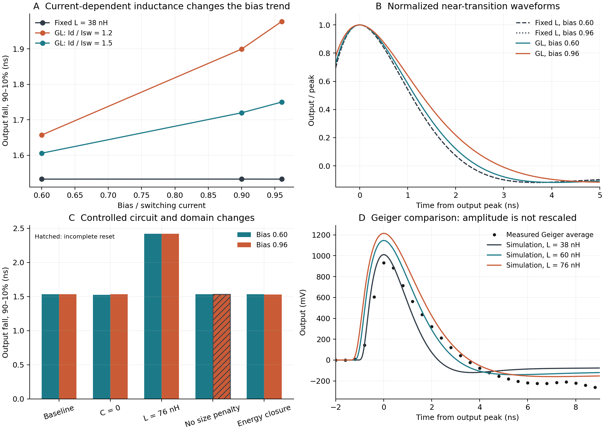
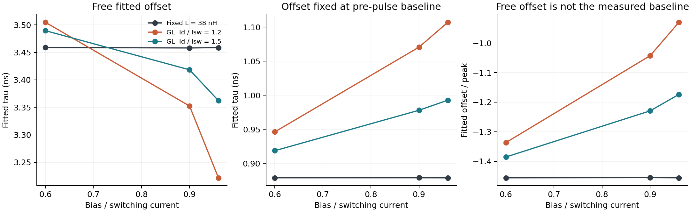

# Recovery-time experiment

Simulation study, 18 November 2026. The baseline is commit
`cfc54bebda4ebc20d0cc99dafd733c74eb03ea32`.

## Question and controls

Does the weak bias dependence of the output fall duration arise from the
normal-domain dynamics or the electrical recovery circuit?

The main comparison uses 11.47 K, a 13 µA switching current, N = 10, and the
packaged 30 pF circuit. Bias fractions are 0.60, 0.90, and 0.96. Every change is
made separately: RF capacitance, electrical inductance, finite-size penalty,
domain-energy approximation, or current-dependent inductance. Changing the
electrical inductance does not change the inferred wire geometry: the original
`Lind=38n` geometry parameter is retained throughout.

The primary observable is the first descending 90–10% output duration. The
analysis also fits `A exp[-(t-t_start)/tau] + C` over the first 85–15% and 70–30%
falling segments. It reports both a free offset and an offset fixed at the
pre-pulse baseline. Simulation fits use equally spaced times to avoid weighting
by the solver's adaptive time step. Experimental points retain their original
sampling. A fitted time constant is not assumed to equal an electrical pole.

## Current-dependent inductance probe

The probe uses the quasistatic near-$T_c$ law from Clem and Kogan (2012).
Its equations, citation, and numerical guard are defined in the
[GL reference](../../docs/current_dependent_inductance.md#constitutive-law-and-scope).
This experiment tests `L0 = 38 nH` with `Id/Isw = 1.2` and `1.5` to assess
sensitivity; these are trial parameters, not measurements.

## Results



Output fall durations below are in ns, at N = 10:

| Change | 0.60 Isw | 0.96 Isw | Recovery at both biases |
|---|---:|---:|---|
| Baseline, fixed 38 nH | 1.5330 | 1.5330 | Yes |
| RF capacitance set to zero | 1.5237 | 1.5354 | Yes |
| Fixed inductance doubled to 76 nH | 2.4207 | 2.4199 | Yes |
| Finite-size penalty removed | 1.5330 | 1.5329 | No: high-bias residual resistance |
| Optional domain-energy approximation enabled | 1.5328 | 1.5294 | Yes |
| GL inductance, Id/Isw = 1.5 | 1.6060 | 1.7500 | Yes |
| GL inductance, Id/Isw = 1.2 | 1.6572 | 1.9770 | Yes |

In the baseline, resistance has already returned essentially to zero by the
output peak. Altering the domain terms changes amplitude and reset behavior but
has little effect on the primary output fall duration. The tested thermal and
domain perturbations therefore do not explain a substantial bias trend in this
observable. Removing the finite-size penalty also leaves approximately 1.95 Ω
at the end of the high-bias run; it is not an acceptable reset correction.

The GL probe produces an increasing 90–10% duration for both trial depairing
currents. Energy dependence is retained, including the N=1 to N=4 peak inversion.

The high-bias probe recovers over an 800 ns observation, the dark input produces
no event, and halving the maximum step changes the fall from 1.976961 to
1.976965 ns. The subsequent [64-run verification](../../docs/validation.md#current-dependent-inductance)
extends these checks to both operating regimes and all packaged circuit variants.

### Fit definition matters



For the GL probe with Id/Isw = 1.2, the free-offset exponential fit gives
approximately 3.50 to 3.22 ns as bias increases, even though the 90–10% duration
increases. The fitted offsets are large and negative relative to the peak; they
are not the measured pre-pulse baseline. A high local fit R² alone does not
establish a single physical exponential decay or justify extracting Lk from
that fitted parameter. RF capacitance strongly affects this fitting behavior:
the zero-capacitance control gives free-offset time constants near 0.85 ns.

The [published dual-mode experiment](https://arxiv.org/html/2410.10280v2)
reports a decreasing fitted calorimetric time constant with bias and uses a
free-offset exponential fit. That observable must be distinguished from an
increasing 90–10% duration. Raw calorimetric bias-sweep traces and the experimental
fit window are needed to determine which feature the model must reproduce.

### Geiger comparison

The packaged Geiger average has a 90–10% duration of approximately 2.4365 ns;
the 38 nH simulation gives 1.5320 ns. A 76 nH trial gives 2.4175 ns, but also
increases the simulated peak from 1010.6 to 1214.7 mV. The figure uses actual
amplitudes and peak alignment, without amplitude rescaling. The measured peak
is 933.0 mV, so the 76 nH trial overpredicts it by approximately 30%. The deposited
experimental energy is unknown. A closer duration alone does not establish an
acceptable fit to the complete waveform.

## Interpretation and next measurement

A quantitative next step requires averaged calorimetric waveforms at several
known bias currents with fixed temperature and optical excitation, including
pre-pulse baseline and full tail. The acquisition interval and exponential-fit
window must be supplied. Fit all biases with common material, readout, and
inductance parameters, then test held-out bias and energy points. The Geiger
waveform provides a separate amplitude-and-shape constraint.

## Reproduction

From the repository root, with the normal package dependencies and LTspice:

```sh
python3 experiments/falling_time/run.py --stage all --jobs 2
python3 experiments/falling_time/report.py
python3 -m unittest discover -s tests -v
```

The runner creates a separate model snapshot and netlist for each case under
`runs/falling_time/`. Existing simulations are analyzed rather than overwritten.
`inputs.json` records the source and installed op-amp hashes; changed baseline
inputs require a separate experiment.
`results.json` retains all completed cases, including unsuccessful recovery
controls, and lists any missing cases. `results.csv` is the compact numerical
table. Large raw traces remain under the ignored `runs/` directory.
